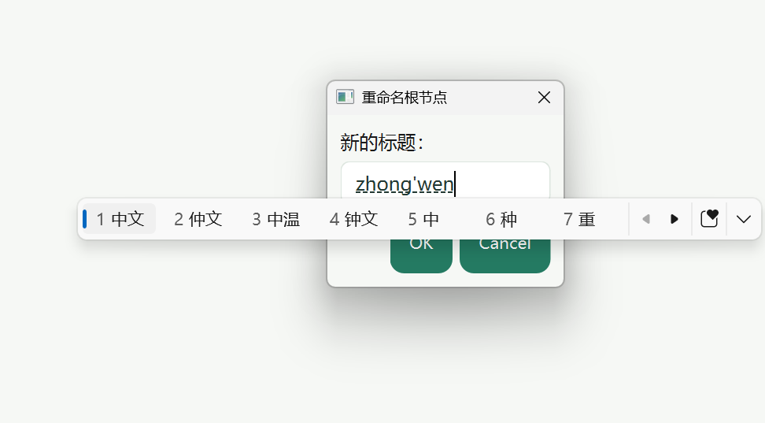
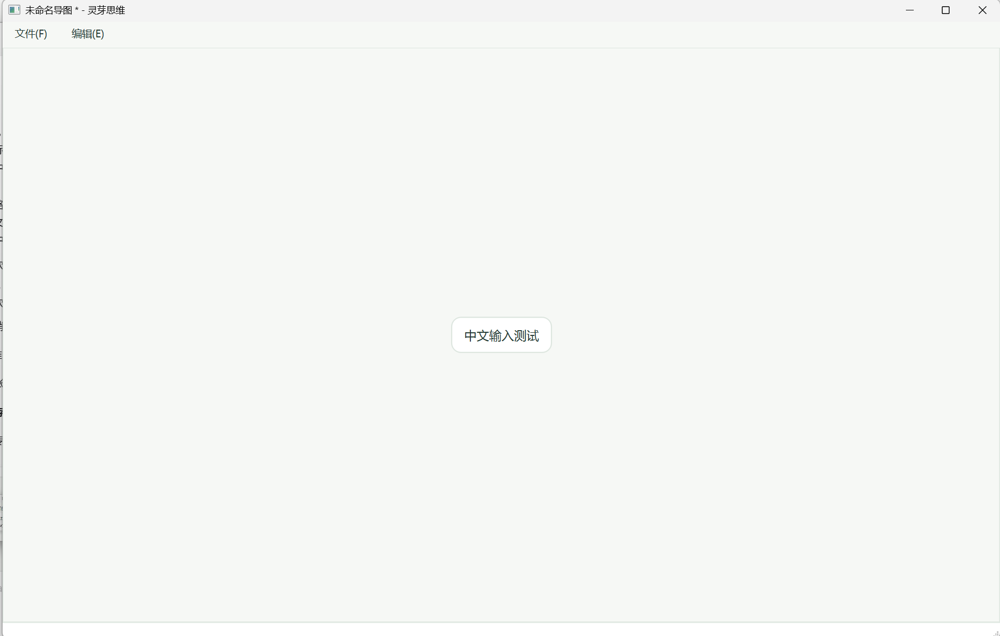
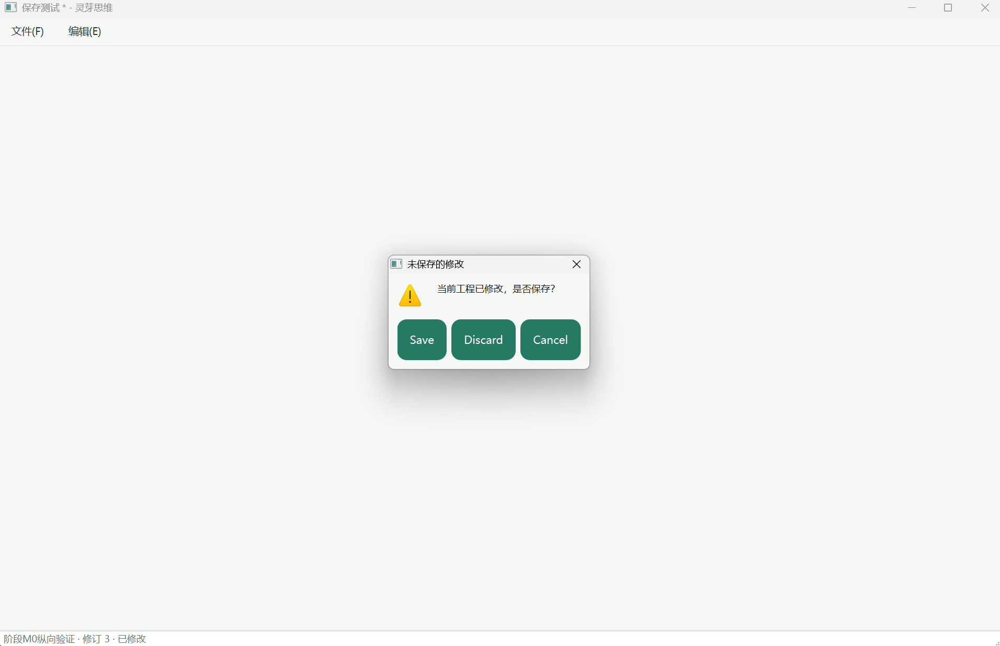
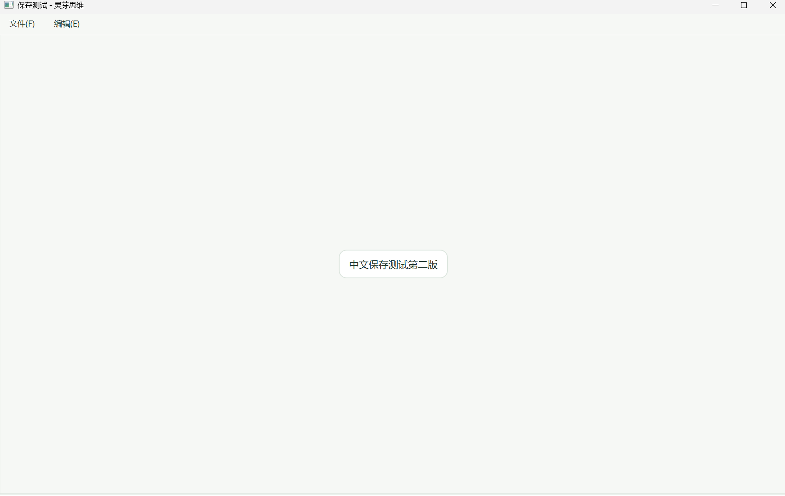
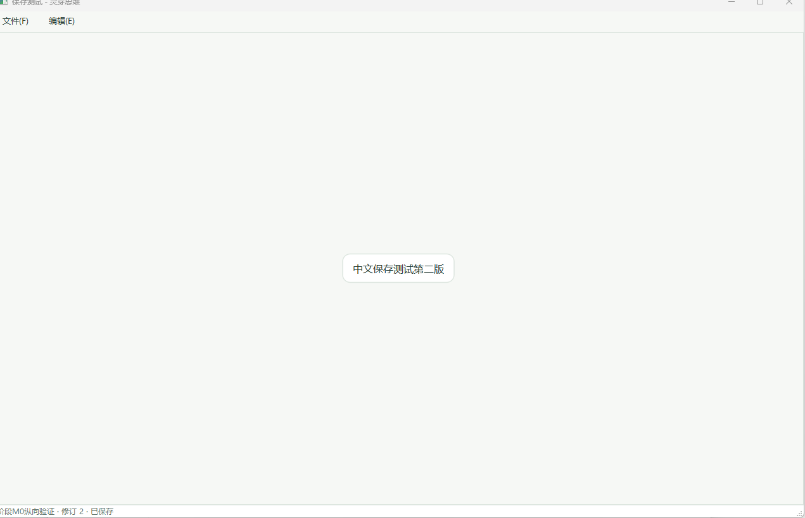
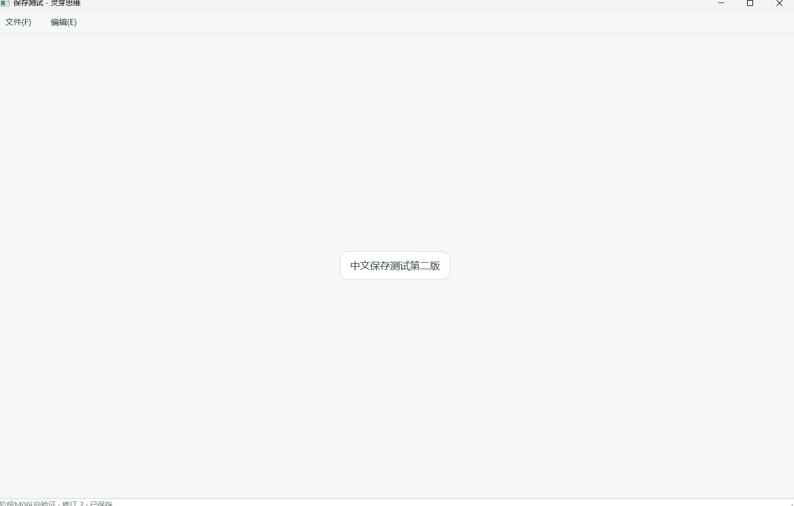

# 甲本人三项人工验收证据

日期：2026-10-24；归档时间：2026-10-24 22:35:46（Asia/Shanghai）。适用范围：M0既有本机人工流程。
操作与签收：甲takagi（Takagi-gif）本人；AI只核对归档与同步。
关联：[验收表](../../acceptance.md)、[交接H-006](../../交接文档.md)、[日志INT-20261024-024 / DEV-20261024-027](../../开发日志.md)。

## 1 来源与结论

甲在本聊天主动提交七张截图，并明确说明：“已全部验收通过，12图对应1，34图对应2，567图对应3，请同步更新上传到GitHub”。
这里的三项是上一轮逐步清单的输入法预编辑、完整保存关闭重开、Windows100%/125%/150%缩放。

| 项目 | 结论 | 证据依据 |
|---|---|---|
| 输入法预编辑 | 甲本人实测确认通过 | 图1–2；候选显示与中文确认后的节点可见，Esc/选字过程依据本人通过确认 |
| 完整人工保存关闭重开 | 甲本人实测确认通过 | 图3–4；关闭提示与重开后第二版内容可见，完整操作时序依据本人通过确认 |
| DPI三档 | 甲本人实测确认通过 | 图5–7；依据本人对100%/125%/150%操作清单的确认；原图未展示系统设置比例，不按图片尺寸独立断定单张比例 |
| 无Qt电脑跨机验证 | 仍跳过、未验收通过 | IF-005 / D-M0-16，未包含在本次三项中 |

## 2 文件与可见状态

七图按用户原顺序命名，仅改文件名，原PNG字节不修改、不裁剪、不重绘。截图中只有本项目测试内容，未见密钥或私人正文。

| 图号 | 原图 | 对应项目 | PNG尺寸 | 直接可见状态 |
|---|---|---|---|---|
| 1 | [01-输入法预编辑.png](01-输入法预编辑.png) | 输入法预编辑 | 972×537 | 拼音与候选栏同时显示，重命名窗口保持打开 |
| 2 | [02-中文输入完成.png](02-中文输入完成.png) | 输入法预编辑 | 1924×1225 | 中心主题为“中文输入测试”，标题栏有修改标记 |
| 3 | [03-未保存关闭提示.png](03-未保存关闭提示.png) | 保存关闭重开 | 1912×1236 | 未保存修改提示与Save/Discard/Cancel按钮 |
| 4 | [04-重开后第二版内容.png](04-重开后第二版内容.png) | 保存关闭重开 | 1914×1210 | 文件基名“保存测试”、节点“中文保存测试第二版”，标题栏无修改星号 |
| 5 | [05-DPI第一张.png](05-DPI第一张.png) | DPI三档 | 1271×819 | 第一张缩放截图，节点、菜单和已保存状态可见 |
| 6 | [06-DPI第二张.png](06-DPI第二张.png) | DPI三档 | 1590×1015 | 第二张缩放截图，中文节点、菜单与窗口控件可见 |
| 7 | [07-DPI第三张.png](07-DPI第三张.png) | DPI三档 | 1908×1228 | 第三张缩放截图，中文节点、菜单与窗口控件可见 |

## 3 版本与证据边界

- 人工操作前会话源码：`daf3c915ce95abcd24140ff0329e1da09a69ec87`。
  已核对其src/tests/tools/CMake与`4713a79839abefab3112d332dabce68578328e42`一致；本机最后验证JSON的sourceCommit也是4713a79。
- 原图不含SHA或二进制校验值，不能仅凭图片独立鉴定运行版本；本记录接受甲本人对已执行清单的明确确认。
- 文档归档前取得最新main：`080385afd8bdbf4e5bc39d2fbf023eabdaaa909b`，其中S01外部修改检测与X03任务双向改名是后续源码变更。
  本次未重新构建或再做人工测试，不能说上述新增代码已被这七图验证，也不把旧105项自动结果套给最新main。
- 截图是关键状态佐证，不是全程录像。Esc、撤销重做、关闭重启等完整步骤依据甲本人通过声明，不虚构AI独立复测。
- 输入法产品名、每张DPI图对应的系统设置数值截图、恢复原缩放值、测试工程完整路径及.lingya原文件未提供，不编造这些信息。
- 图中Qt标准按钮仍有OK/Cancel/Save/Discard英文，本轮三项交互通过不代表标准按钮汉化或全中文终验已完成。
- 结论不扩展为多级节点编辑、坏文件人工验证、全部M1、无Qt跨机或M6交付通过。

## 4 原图完整性（SHA-256）

| 图号 | SHA-256 |
|---|---|
| 1 | `8799e88d2be060931a99e98201296a7f57945c2ceb0910a0e7ae9c1cbb9ed9e5` |
| 2 | `7612b162f22e3087f4a3575d1b70353c39257699723c16b2ad982e6409de5de7` |
| 3 | `6887b2d7160dcfb7de8f48d4ca771b052e3c007391045fc74e6fb710e5d516e6` |
| 4 | `7e794cdacb3632ade90176d6dc82ffaa32e023bb5dfcf81b8951422069d10521` |
| 5 | `bf8258aefdd4578ee24129cbee455d9fb02e31b88a34fc1cfdd1ed90372c3478` |
| 6 | `ff0b6231662acfb522ac94dbff31d7bff3b666484f0ad355b186418ec85d5f16` |
| 7 | `540d9c20970111c3ff4faee852774044aa48755e07bbd7e6a0a29f78d030c805` |

复查可在本目录用PowerShell执行`Get-FileHash -Algorithm SHA256 *.png`，逐张对照本表；图号对应文件名。

## 5 原图预览

### 图1：输入法预编辑

### 图2：输入法预编辑

### 图3：保存关闭重开

### 图4：保存关闭重开

### 图5：DPI三档

### 图6：DPI三档

### 图7：DPI三档

