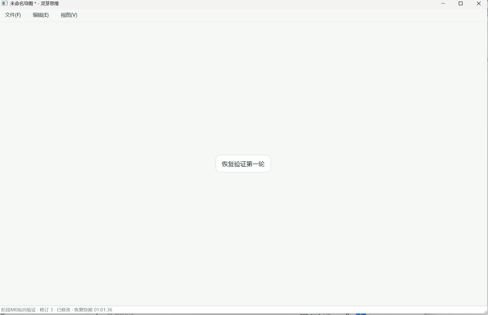
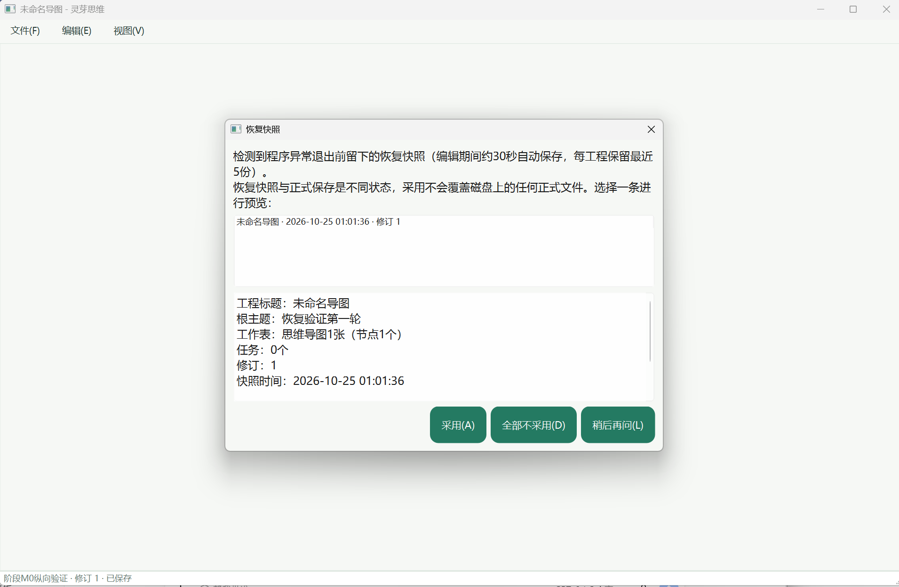
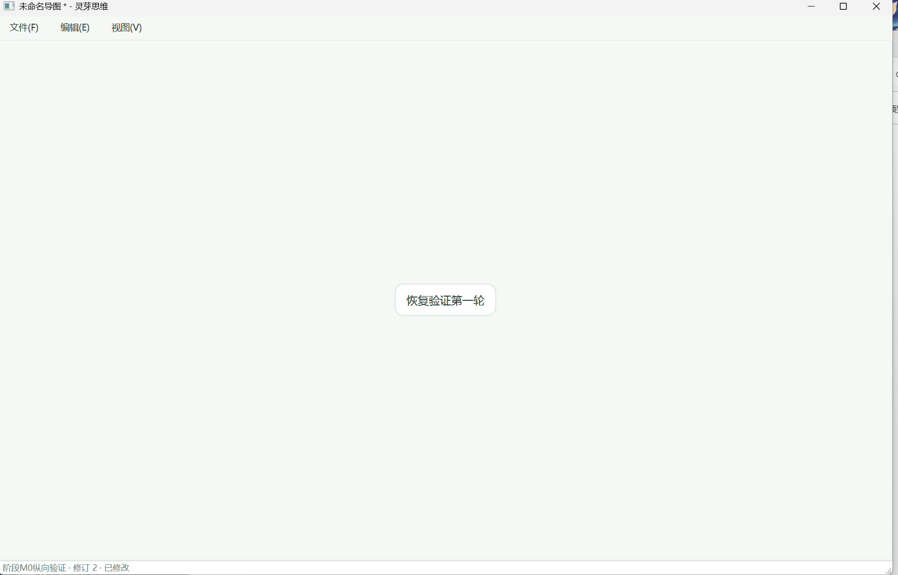
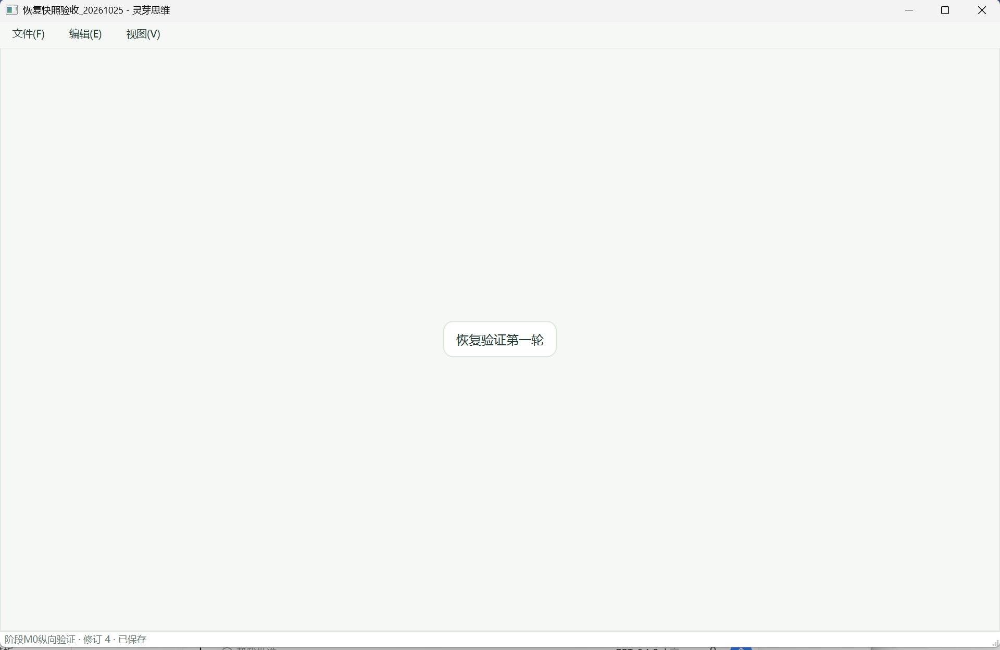
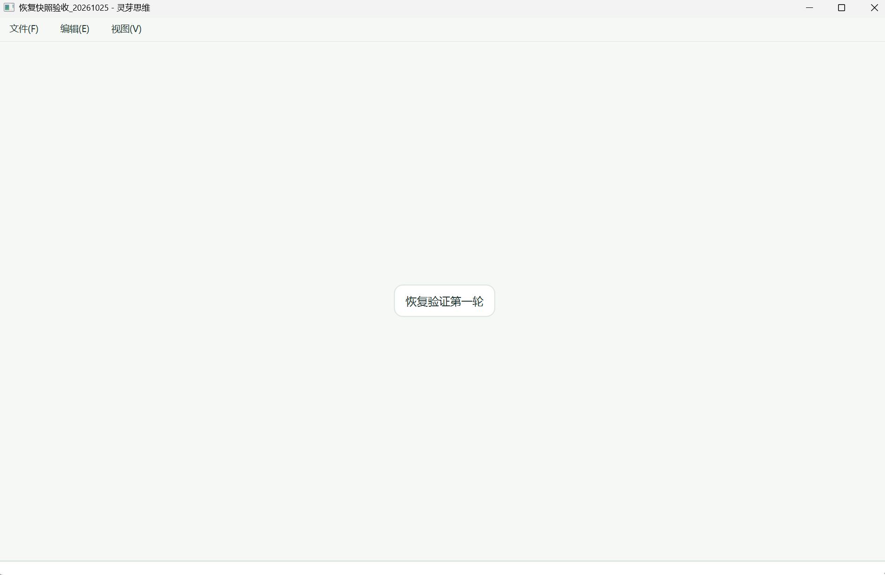

# 恢复快照人工验收：甲本人五图证据

日期：2026-10-25；归档时间：2026-10-25 01:14:11（Asia/Shanghai）。适用范围：DEV-030甲评审修正分支的真实崩溃恢复。
操作者与结论：甲takagi（Takagi-gif）本人；AI只核对、归档与上传。
关联：[验收](../../acceptance.md)、[H-010交接](../../交接文档.md)、[INT-20261025-003日志](../../开发日志.md)、[评审](../../reviews/DEV-030-甲复核.md)。

## 1 本人确认与检查范围

本人原话：“已验收完成，全部通过，截图按照你要求的都有”。按上一轮详细步骤，确认以下七项通过：

1. 未保存编辑出现恢复快照时间。
2. 第一次结束进程后能预览、采用。
3. 采用后快速再次结束进程，再次启动仍可恢复。
4. Ctrl+Z/Ctrl+Y撤销、重做正确。
5. Ctrl+S进入另存为，取消后内容与脏状态保留。
6. 正式保存、正常关闭、重开内容一致。
7. 保存后不再提示本工程待恢复。

静态截图佐证关键状态；结束进程次数、快速退出时序、撤销重做及取消等过程依据本人完整通过声明。
未提供连续录像或精确秒数，不声称从截图测得“10秒内”或“30秒内”；无须为本次归档编造这些数值。

## 2 图号对应

| 图号 | 原图 | 尺寸 | 直接可见状态 |
|---|---|---|---|
| 1 | [01-恢复快照已写入.png](01-恢复快照已写入.png) | 1918×1242 | 未命名导图有修改星号，根主题“恢复验证第一轮”，状态栏显示恢复快照01:01:36 |
| 2 | [02-重启后的恢复预览.png](02-重启后的恢复预览.png) | 1911×1246 | 恢复对话框显示2026-10-25 01:01:36的快照与“恢复验证第一轮”预览 |
| 3 | [03-采用后的未保存内容.png](03-采用后的未保存内容.png) | 1929×1237 | 恢复主题显示，标题栏有星号，状态栏为已修改 |
| 4 | [04-恢复内容正式保存.png](04-恢复内容正式保存.png) | 1920×1248 | 文件名“恢复快照验收_20261025”，无修改星号，状态栏已保存 |
| 5 | [05-正式文件关闭后重开.png](05-正式文件关闭后重开.png) | 1905×1239 | 最终重开的窗口显示“恢复快照验收_20261025”和同一根主题，无修改星号 |

## 3 版本与边界

- 人工操作前会话与本地提交：`bfaf78fc3237d9f068f276644d6d53843328f99d`，分支fix/a/S01-recovery-review。
- 其源码与已验证`dc580f9b871dfac5f97b6b1ca076ed22d0f2406c`一致；本轮只更新文档/证据。图片本身不带SHA，不能独立鉴定二进制版本。
- 图片可见快照时间2026-10-25 01:01:36；未把该快照时间冒充整轮验收的准确开始/结束时间。
- 归档时远程main=18426f3已集成其他基础件，恢复分支base更新到6236870；本次验收不自动覆盖它们的新代码。
- 五图均原样复制，只改文件名，未裁剪或重绘；未上传真实工程文件或本机完整保存路径。
- 原甲H-009与main丙H-009碰号，现为H-010；甲自动INT-001现为INT-002，本次真实人工为INT-003。保留历史更正，不覆盖其他成员记录。
- 这次人工通过不代替乙丙代码评审，PR #16仍待独立复核；无Qt电脑跨机按IF-005继续暂缓、未通过。

## 4 原图SHA-256

| 图号 | SHA-256 |
|---|---|
| 1 | `be746776edf21b870ebcde7492dfb4781e8a38e9edb82c52782ada5dea80ea45` |
| 2 | `5aa55feaa14fd95d055b0d439e287dcc1fdc235faa7897c88daf184519b92eab` |
| 3 | `4f13843e6962e08185e53faab82a120422ba0ffc0419fc5eee17eaca9206d586` |
| 4 | `104b4e7e14716f02af2d6ad0924e4534c4863ef1376492774c4182df50464cc6` |
| 5 | `25830432322eb757daba80934dbc98d84088053c2ac8d5ce2351f440e01878e6` |

## 5 原图预览

### 图1

### 图2

### 图3

### 图4

### 图5

