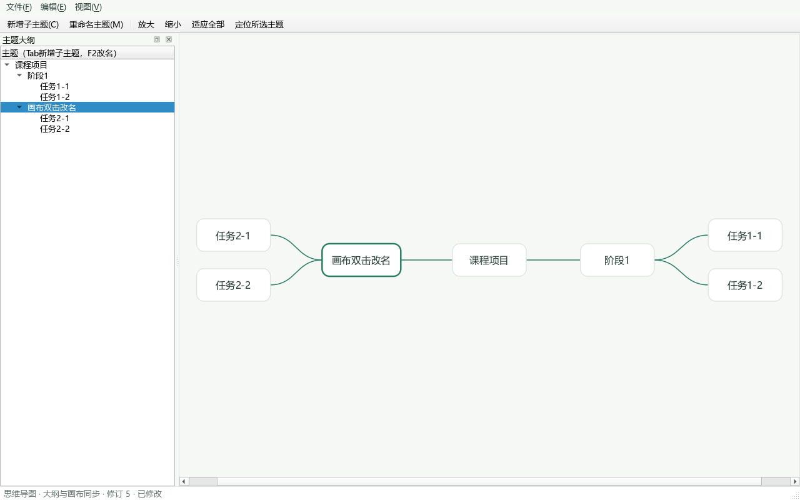

# 甲M1整树画布接入与验收

交付：H-012 / DEV-20261025-005。分支：feature/a/M1-editor-integration。
基线：乙TreeLayout已合入main=e7bb883；甲普通合并为7c73542；本轮代码提交51736ca。
本批在本地分支交付，尚未上传或合入main，乙丙非作者评审与本人新版本人工验收待完成。

## 1 本轮变化

上一批H-011右侧仅显示所选主题预览。本批改为调用乙的TreeLayout显示整棵树：

1. 用与NodeItem绘制相同的Microsoft YaHei、16逻辑像素字体测量标题，含内边距与边框范围。
2. 将每个节点的ID、宽、高组成NodeSize数组，调用TreeLayout::layout(sheet, sizes)。
3. 按NodePosition.id映射到NodeItem，setPos使用返回的中心坐标，根节点位于原点。
4. 从父子ID关系绘制曲线，端点落在实际节点边缘，连线置于节点后方且不接收鼠标。
5. 位置仅用于视图，不写入JSON、不改变工程数据，也不新增撤销记录。

乙的TreeLayout源码、算法、Domain/JSON、服务与命令契约、CMake均未由甲修改。
布局仍是M1简化版；本批不宣称M2的完整均衡布局R10完成。复杂深宽悬殊结构的轮廓优化沿用乙的后续计划。

## 2 当前可用操作

| 操作 | 方法与结果 |
|---|---|
| 查看整树 | 打开/新建后显示当前树工作表的可见节点及父子曲线 |
| 选择 | 点击画布节点或大纲条目，两边保持同一单选节点，不改文档 |
| 新增子主题 | 工具栏/编辑菜单或非编辑状态Tab；根节点Enter也新增子主题；成功后自动选中新节点并定位 |
| 改名 | 双击画布节点、双击大纲条目或F2；统一调用TaskCommands::renameNode，同步关联任务 |
| 多行标题 | Shift+Enter换行，Enter或数字键盘Enter确认，取消按钮/Esc取消 |
| 输入法 | Qt预编辑期间Enter不提交对话框；真实Windows输入法仍待本人复验 |
| 撤销重做 | Ctrl+Z、Ctrl+Y/Ctrl+Shift+Z；画布与大纲按唯一文档刷新，选择失效回根节点 |
| 查看全图 | 点击“适应全部”；按钮/滚轮缩放25%—200%；空白拖动平移 |
| 定位 | “定位所选主题”，或从大纲选择，让所选节点进入可视范围 |
| 保存重开 | 原文件、备份、外部修改、恢复机制沿用；重开后重新从文字尺寸计算位置 |

超大导图在25%最小缩放时可能仍超出窗口，应配合滚动、拖动和定位查看；“适应全部”遵守缩放边界。
当前画布为单选，不支持结构拖动、多选、同级新增或子树删除；后两项待乙命令。

## 3 折叠与定位的边界

- 初始显示遵守文件里的collapsed字段，隐藏其后代。
- 大纲仍能列出全部节点；选择隐藏节点时，仅在显示副本中临时展开祖先路径，方便定位。
- 临时显示不修改collapsed、dirty、修订号或撤销历史；保存后重新打开仍遵守文件折叠状态。
- 大纲的展开收起仍是界面状态。持久化折叠编辑命令尚未交付，不混称为完整折叠功能。

## 4 启动及本人验收（待执行）

在本仓库的PowerShell 7执行：

```powershell
git branch --show-current
# 应为feature/a/M1-editor-integration
.\tools\打开灵芽思维.ps1
```

如有旧程序窗口，请先自行保存并关闭，再启动当前分支。旧窗口不会因切分支自动更新。

本人验收清单：

1. 新建工程，F2将根节点改为“课程项目”；根节点Tab新增“需求分析”，再选择根节点Tab新增“开发实现”。检查双侧显示和连线。
2. 选“需求分析”，Tab新增两级子主题；在大纲和画布分别点击，确认高亮、F2目标一致。
3. 双击非根节点改名，Ctrl+Z撤销、Ctrl+Y重做；新增后撤销，确认没有悬空选择或残留连线。
4. 改名时用拼音候选输入中文；Enter确认候选时不应误提交/新增。用Shift+Enter输入两行，Enter确认，Esc取消另一次编辑。
5. 检查长中文、放大缩小、适应全部、空白拖动；移开画布后用“定位所选主题”找回目标。
6. 保存到新的临时.lingya文件，关闭并重开；核对层级、标题、换行和父子关系。取消关闭应保留未保存内容。
7. Windows100%/125%/150%分别检查大纲、工具栏、编辑框及画布；本次结果不沿用M0截图。
8. 使用受控的100节点样本检查滚动、选择、改名、撤销和保存；自动验证样本不等同全部规模/结构都已人工通过。

无Qt电脑跨机验证仍按IF-005暂缓；本清单不要求重复安装或重测已闭合的恢复快照批次。

## 5 自动验证和证据

新增四项集成测试：

- 整树：7节点6连线、左右分侧、连线端点、画布点击与大纲同步、双击改名、撤销重做、定位。
- 100节点：使用实际字体测量，含长中文和换行；100节点99连线、坐标有限、该样本节点框不重叠，保存重开后位置、尺寸和标题一致。
- 折叠：初始隐藏后代；大纲定位临时展开；工程折叠字段、脏标记和修订号不变，重开恢复隐藏。
- 标题：Shift+Enter、合成Qt预编辑/提交事件、Enter确认和取消不修改。合成事件不代替真实输入法测试。

```powershell
.\tools\验证环境.ps1 -Configuration Both
git diff --check
```

最终自动结果见H-012与[脱敏验证摘要](evidence/20261025-甲整树画布/自动验证摘要.json)。
代码51736ca上实测：Debug/Release各15套件226项通过，0失败0跳过；tst_ui各26项。
原验证脚本退出0；另逐套输出30份XML核对数量。上述通过不包含真人输入法、DPI和非作者评审。
本机原始报告：build/tree-validation-console.log、build/environment/validation.json、build/tree-evidence/debug与release。
计数包含QtTest初始化和清理，不把统计项数等同独立业务用例数。



截图由受控临时工程在offscreen平台加载微软雅黑和现有light.qss生成，非用户桌面截图，不能作为真实输入法或DPI验收证据。

## 6 接收安排

- 乙复核：TreeLayout调用、测量与绘制一致性、视图生命周期及文件重开；后续交付addSibling/deleteSubtree。
- 丙复核：操作流程与甘特接入未退化；复习/AI页面按原职责维护。
- 甲本人：完成上述人工清单并提交实际证据。
- 本批没有自批或合入main；未改文件格式，需回退时按本轮提交普通revert，保留原工程和验收资料。

编号更正：乙已占用DEV-20261025-003登记布局，甲H-011历史同号记录改按DEV-20261025-004引用；本批为DEV-20261025-005。历史原文和提交不改写。
