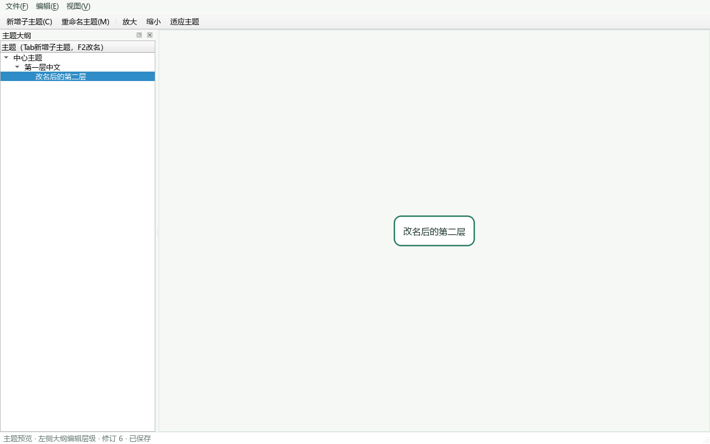

# 甲M1第一批界面接入与验收

本文保留H-011历史交付。当前本地分支已继续接入乙TreeLayout与多行编辑，入口改看[H-012整树画布说明](甲M1整树画布接入与验收.md)；本文“待布局/单主题预览/单行编辑”描述仅对应原4d134d9版本。

角色：甲takagi。关联：DEV-20261025-003、H-011。基线：main=c780b50；代码提交：4d134d9。
本批是甲的本地待评审交付，不能将本文当作main已集成或M1全部通过的证明。

## 1 本轮能使用什么

| 操作 | 方法 | 实际行为 |
|---|---|---|
| 查看层级 | 左侧“主题大纲” | 展示活动树工作表的全部节点，按order、ID稳定排序 |
| 新增子主题 | 工具栏/编辑菜单，或大纲与预览区按Tab | 调用乙的NodeCommands::addChild，新节点自动选中 |
| 根节点新增子主题 | 选中根节点，按Enter | 与“新增子主题”使用同一入口 |
| 修改标题 | 选中节点后F2，或双击大纲/预览节点 | 调用TaskCommands::renameNode，关联任务同事务改名 |
| 标题规则 | 在标题对话框输入 | 去除首尾空白；空白转“未命名主题”；超过2000个Unicode码点拒绝 |
| 取消编辑 | 标题对话框按Esc或取消 | 不改内容、不新增历史 |
| 撤销/重做 | Ctrl+Z / Ctrl+Y或Ctrl+Shift+Z | 共用原CommandService；撤销新增后选择失效则回根节点 |
| 保存和重开 | Ctrl+S / Ctrl+Shift+S，文件菜单打开 | 沿用FileService、原子保存、备份及外部修改检测 |
| 查看完整长标题 | 在大纲选择主题 | 右侧预览自动换行，不用省略号替代真实标题 |
| 缩放和平移 | 放大/缩小、鼠标滚轮、空白拖动 | 缩放限制25%—200%；“适应主题”调整到可见范围，不改文档 |
| 甘特预览 | 视图→甘特图 | 首次创建丙的GanttView，后续复用；数据随修改、撤销、重开刷新 |

右侧目前是**所选主题的预览**，不绘制完整树和连线。所有层级已经能在大纲中真实编辑、撤销和保存。
大纲展开/收起仅为本次会话的视图状态，不等于持久化的节点折叠命令。
标题输入目前采用Qt标准单行对话框；Shift+Enter多行编辑、同级Enter、Delete等完整M1交互未交付。
甘特基础视图目前只读，未排期任务不画条；任务编辑、时间刻度、进度、依赖连线仍按丙的后续范围推进。

## 2 启动本轮版本

在本仓库打开PowerShell 7终端：

```powershell
git branch --show-current
# 应为feature/a/M1-editor-integration
.\tools\打开灵芽思维.ps1
```

若已有旧版本窗口，启动入口会保留它。请先自行保存并关闭旧窗口，再启动本分支；不要把旧窗口当成本轮版本。
上述启动脚本和本机双击入口都会从当前分支构建。现有人工验收文件保留，不使用真实用户工程做破坏性测试。

## 3 本人实际操作验收清单（待执行）

1. 新建临时工程，选根节点，按F2，用拼音候选输入“课程项目”；候选确认不应误触新增。
2. 选根节点，按Tab输入“需求分析”；选新子主题再按Tab输入“功能清单”。左侧应有三层。
3. 选“功能清单”，双击或F2修改为“中文功能清单”；右侧预览应对应所选主题。
4. 先Ctrl+Z撤销改名，再Ctrl+Z撤销新增；选择应回到有效节点。Ctrl+Y重做后层级应恢复。
5. 再开标题对话框，输入文字后按Esc；内容不变。输入空格并确认时应变为“未命名主题”。
6. 输入一段长中文标题，检查预览完整换行；点击放大/缩小、滚轮和“适应主题”，检查25%—200%边界以及空白拖动。
7. 保存到新的临时.lingya文件，关闭后重开，核对节点层级和所有标题一致；有未保存内容时取消关闭应保留内容。
8. 如有受控的含已排期任务工程，打开“视图→甘特图”，观察时间轴；空工程应有暂无任务的状态提示。
9. 在Windows100%/125%/150%分别检查大纲、工具栏、对话框和预览。此次结果不能沿用M0旧截图。

以上尚未由本人执行。自动Qt事件测试和下图只证明程序逻辑及无屏幕渲染，不代替Windows输入法、DPI或真实鼠标流程。

## 4 自动验证与截图

本轮沿用冻结工具：Qt6.8.3、MinGW13.1.0、CMake3.30.5、Ninja1.12.1、clang-format19.1.7。

```powershell
.\tools\验证环境.ps1 -Configuration Both
git diff --check
```

新增五项集成测试：多级编辑保存重开、取消和撤销选择、统一改名与任务联动、甘特懒加载与数据刷新、长标题和缩放边界。
4d134d9上实测：Debug/Release各14套件204项通过，0失败0跳过；tst_ui各22项通过。
计数包含QtTest初始化/清理，不等同204个独立业务用例。原验证脚本退出0；随后逐套输出XML复核计数。
脱敏结果见[自动验证摘要](evidence/20261025-甲M1界面接入/自动验证摘要.json)。
本机原始报告：build/environment/validation.json、build/m1-validation-console.log、build/m1-evidence/debug与release的XML。
CTest在当前Windows环境没有捕获到QtTest逐项stdout，不能从空输出推断逐项数量；本次以额外XML实测为准。



截图来源为tst_ui的受控临时工程、offscreen平台，加载本机微软雅黑与现有light.qss；不是用户桌面截图。
该图展示三层结构和第二层改名后的预览，不证明真实输入法与高DPI。原始测试输出保留在build目录。

## 5 交给队友的下一步

- 乙：按H-008提供最小树布局，输入甲的节点测量尺寸，输出NodePosition；本批NodeItem::boundingRect已提供完整文字尺寸。然后由甲接通整树画布。
- 乙：提供addSibling、deleteSubtree及其引用清理策略后，由甲接Enter同级和Delete，沿用命令事务与撤销。
- 丙：复核甘特setTasks接入和刷新；继续任务编辑、未排期列表、进度及依赖功能。
- 乙丙：独立复核本批源码和测试。甲不得自批、自合并后宣布阶段通过。
- 复习/AI页由丙维护；甲之后按阶段提供宿主与视觉复核。本批不调用真实API、不处理密钥。
